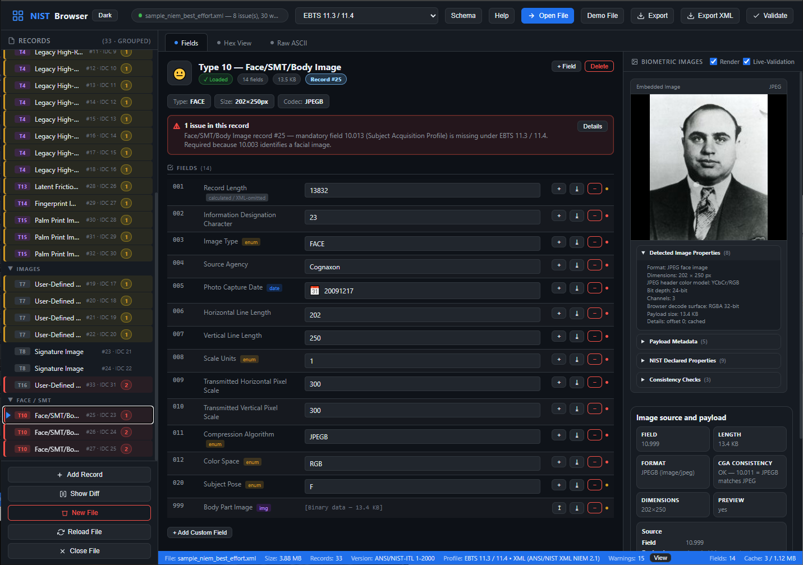
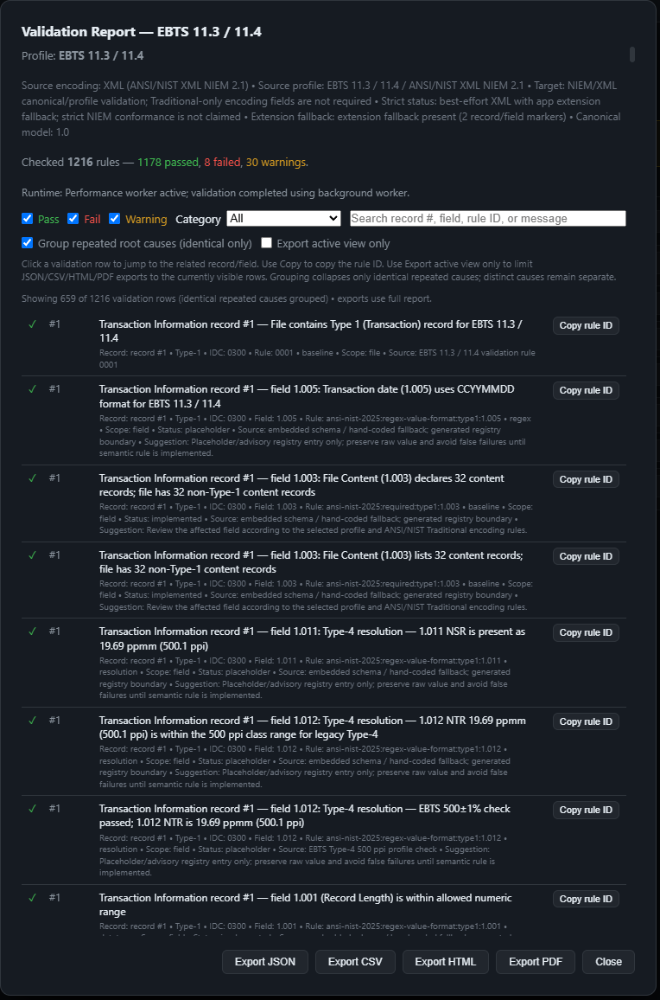
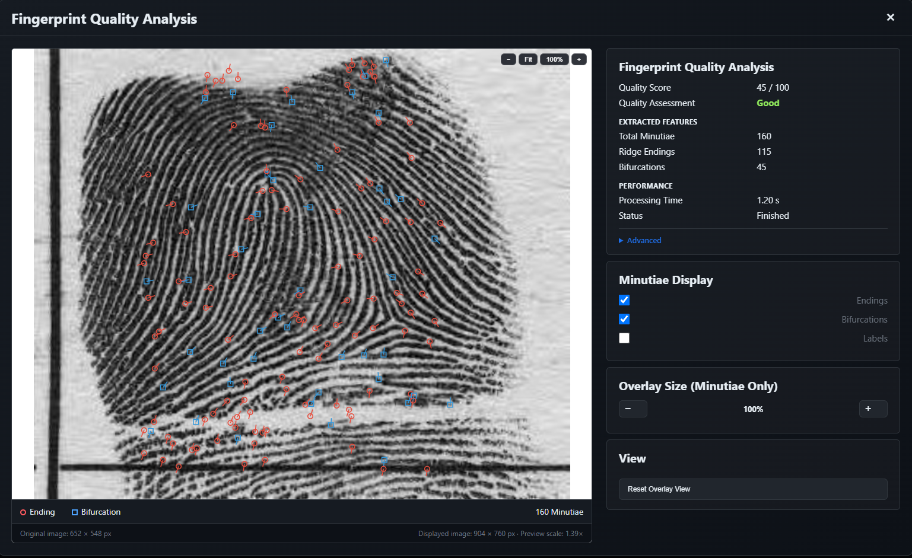

# NIST Editor

### Advanced ANSI/NIST Biometric File Viewer, Editor, Validator & Analysis Tool

**Free for everyone · Works offline · Windows 10/11**

[**Download Latest Release**](https://github.com/nadrianstoica/NIST-Editor/releases/latest) · [**Official Website**](https://nadrianstoica.github.io/NIST-Editor/)

---

## Understand, Validate and Edit Biometric Transactions

**NIST Editor** is an independent application for working with ANSI/NIST-ITL biometric interchange files.

Designed for biometric engineers, forensic specialists, system integrators, researchers, and organizations working with biometric identification systems, it brings together file inspection, editing, validation, format conversion, image decoding, and fingerprint quality analysis in one application.

Whether you need to investigate a rejected biometric transaction, validate interoperability, inspect an unusual field, compare two files, or analyze fingerprint quality, NIST Editor provides visibility into both the **logical structure and underlying binary representation** of biometric data.

**No license fees. No separate commercial-use license required. No cloud dependency.**

## Key Capabilities

### Inspect and Edit ANSI/NIST Files

Open and explore biometric transactions through a structured, hierarchical interface.

- Inspect records, fields, subfields and information items.
- Create or modify supported biometric record types.
- Explore source data through Hex, Raw ASCII and hierarchical Structure views.
- Preserve original data where possible, including binary payloads and source formatting.
- Automatically maintain structural information such as record lengths and transaction content.

### Validate Against Biometric Standards

Identify potential interoperability issues before files reach receiving systems.

- Built-in ANSI/NIST-ITL standards and implementation profiles.
- Support for FBI EBTS, INTERPOL and additional profiles.
- Mandatory-field, format, range and code-table validation.
- Cross-field and cross-record consistency checks.
- Image metadata, resolution, compression and DPI diagnostics.
- Contextual validation messages and suggested corrections.

### Compare Transactions — Beyond Logical Differences

Investigate not only *what* changed, but *how the file is represented*.

- Compare record and field contents.
- Identify logical differences between transactions.
- Detect binary representation differences even when logical values match.
- Examine original field-tag formatting, encoding, separators and source bytes.
- Diagnose differences that can affect receiving-system interoperability.

### Traditional and XML Support

Work with both Traditional ANSI/NIST and supported XML representations.

- Import and export supported file representations.
- Convert between Traditional and XML formats.
- Preserve supported biometric metadata and binary content.
- Inspect and validate converted transactions.

### Biometric Image Inspection

Preview and investigate embedded biometric images using supported decoders and metadata inspection tools.

Supported formats include **WSQ, JPEG, JPEG 2000, PNG, BMP, TIFF, JPEG-LS, DICOM and raw raster data**.

### Integrated NFIQ2 Fingerprint Quality Analysis

Analyze suitable fingerprint images directly within the application.

- Fingerprint quality scores and diagnostic information.
- Minutiae statistics.
- Ridge-ending and bifurcation visualization.
- Quality overlays displayed over the analyzed fingerprint.
- Exportable analysis results and images.

NFIQ2 eligibility depends on image content and applicable analysis requirements.

### Local Processing and Privacy

**Your biometric files remain on your computer.**

NIST Editor performs its supported file editing, decoding, validation, conversion and quality-analysis operations locally, without requiring biometric data to be uploaded to a cloud service.

---

## Supported Standards and Record Types

NIST Editor includes support for multiple ANSI/NIST-ITL editions, including 1-2011 and 1-2025, together with FBI EBTS, INTERPOL and other supported implementation profiles.

Its record-handling capabilities cover transaction information, descriptive text, fingerprint and palmprint imagery, facial imagery, iris data, minutiae, signatures, voice, dental, DNA, user-defined data and additional biometric record categories.

Specific capabilities and validation requirements depend on the selected standard and record type.

---

## See NIST Editor in Action

### Validation

### Fingerprint Quality Analysis

---

## Free Software License — Personal and Commercial Use

**NIST Editor is free to use by everyone.**

You may use the application for:

- Personal, educational and academic activities.
- Research, development, testing and interoperability work.
- Professional and commercial projects.
- Government, law-enforcement and forensic activities.
- Organizational and production environments.

**No license purchase, subscription, registration, donation or separate commercial authorization is required.**

NIST Editor remains copyrighted software, licensed rather than sold. Free use does not automatically grant permission to redistribute, resell, sublicense or repackage the application, and it does not designate the project as open-source software.

The complete terms, including permitted uses, intellectual-property restrictions, warranty disclaimers and limitations of liability, are available in the application under **About → Software License**.

## Support Independent Development

NIST Editor is independently developed and maintained by Adrian Stoica.

If the application saves you time or helps your work, a voluntary donation is a welcome way to support further improvements.

**Donations are appreciated, never required.** They do not affect your right to use the software.

Voluntary bank-transfer details

| Detail | Value |
|---|---|
| Beneficiary | Adrian Stoica |
| IBAN | RO84 INGB 0000 9999 0039 8942 |
| Bank | INGB CENTRALA |
| Currency | RON |
| SWIFT / BIC | INGBROBU |

---

## Download for Windows

Download the latest published Windows executable from:

**https://github.com/nadrianstoica/NIST-Editor/releases/latest**

Windows builds use .NET 10 and Microsoft Edge WebView2 technology. Runtime requirements may vary by distribution package.

**Latest published version reviewed:** 2.0.467.

---

## Feedback and Contributions

Bug reports, improvement suggestions and compatibility feedback are welcome.

When reporting a problem, please include the application version, relevant steps to reproduce it, and screenshots or diagnostic metadata where available.

Do not upload real biometric records or sensitive personal data to public issues unless you are legally authorized to disclose them.

---

## About the Project

NIST Editor is developed by **Adrian Stoica** as an independent software project.

It is not affiliated with, sponsored by, certified by or officially endorsed by NIST, the FBI, INTERPOL, eu-LISA or other referenced organizations.

References to standards and technologies are for technical and interoperability purposes. Validation results do not constitute official certification of file compliance.

**Copyright © 2026 Adrian Stoica. All rights reserved.**

*Independently developed in Romania.*
